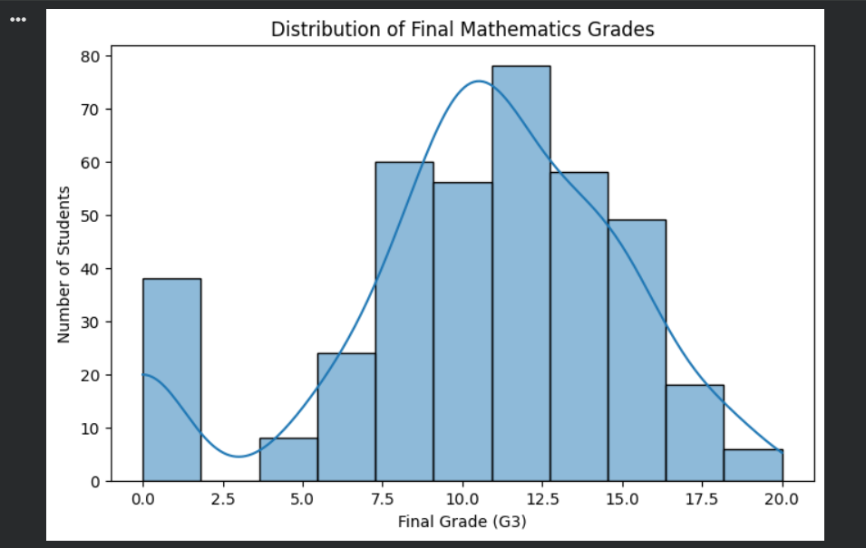
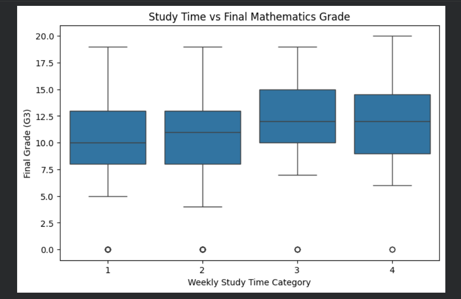
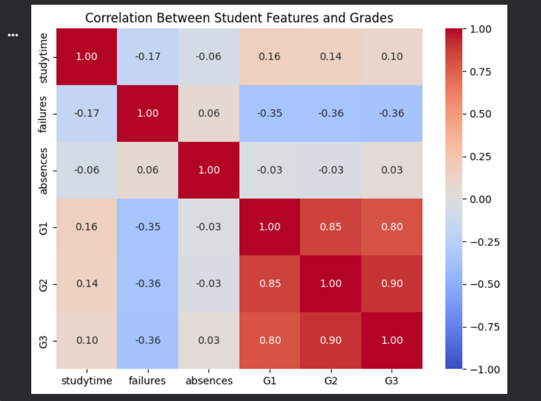
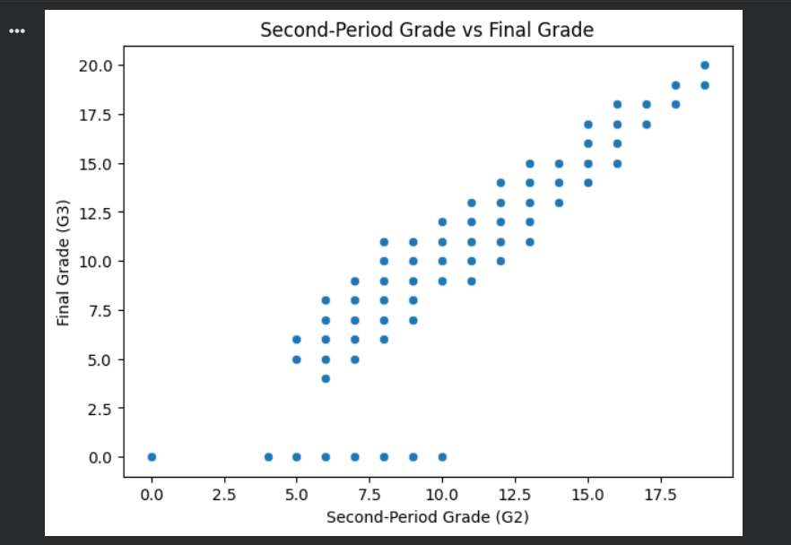
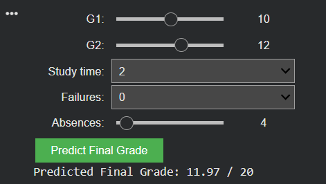

# Student Performance Prediction System

 1. Project Overview

The Student Performance Prediction System is a Machine Learning-based project developed to predict students' final mathematics grades using their previous academic performance and study-related factors.

The project uses Python and the Random Forest Regression algorithm to analyze student data and estimate final examination grades.

 2. Objectives

- Analyze student academic performance data.
- Identify important factors affecting final mathematics grades.
- Perform data preprocessing and exploratory data analysis.
- Develop a prediction model using Random Forest Regression.
- Evaluate model performance using regression metrics.
- Create an interactive prediction interface.

 3. Dataset Description

- Dataset: Student Performance Dataset
- Source: UCI Machine Learning Repository
- File: student-mat.csv
- Total records: 395
- Total attributes: 33
- Selected input features: 5
- Target variable: G3

 Selected Features

1. G1 – First-period mathematics grade.
2. G2 – Second-period mathematics grade.
3. Study Time – Weekly study-time category.
4. Failures – Number of previous academic failures.
5. Absences – Number of school absences.

Target variable: G3 – Final mathematics grade (0–20).

 4. Technologies Used

- Python
- Google Colab
- Pandas
- NumPy
- Matplotlib
- Seaborn
- Scikit-learn
- IPyWidgets
- Pickle

 5. Methodology

1. Dataset collection.
2. Data loading and exploration.
3. Data preprocessing.
4. Exploratory Data Analysis.
5. Feature selection.
6. Training and testing dataset split.
7. Random Forest Regression model development.
8. Model evaluation.
9. Interactive prediction interface development.
10. Model saving and verification.

 6. Model Performance

| Metric | Result |
|---|---:|
| MAE | 1.06 |
| RMSE | 1.65 |
| R² Score | 0.868 |

 7. Sample Prediction

Input values:

- G1 = 10
- G2 = 12
- Study Time = 2
- Failures = 0
- Absences = 4

Predicted final mathematics grade: **11.97 / 20**

 8. Project Screenshots

# Dataset Preview
https://archive.ics.uci.edu/dataset/320/student+performance
# Grade Distribution

# Study Time Analysis

# Correlation Heatmap

# G2 vs G3 Scatter Plot

# Actual vs Predicted Grades

# Prediction Interface

 9. How to Run the Project

1. Download or clone this repository.
2. Open the Jupyter Notebook in Google Colab.
3. Upload the student-mat.csv dataset.
4. Install the required Python libraries.
5. Execute the notebook cells in sequence.
6. Train the Random Forest Regression model.
7. Use the interactive interface to generate predictions.

 10. Future Scope

- Use larger student datasets.
- Include additional academic features.
- Compare different machine learning algorithms.
- Develop a web-based prediction application.
- Extend predictions to multiple subjects.

 11. References

- UCI Machine Learning Repository – Student Performance Dataset
- Python Documentation
- Pandas Documentation
- Scikit-learn Documentation
- Matplotlib Documentation

Dataset: https://archive.ics.uci.edu/dataset/320/student+performance

 12. Author

Name: Savan Saware

Project: Student Performance Prediction System

Domain: AI / Machine Learning 